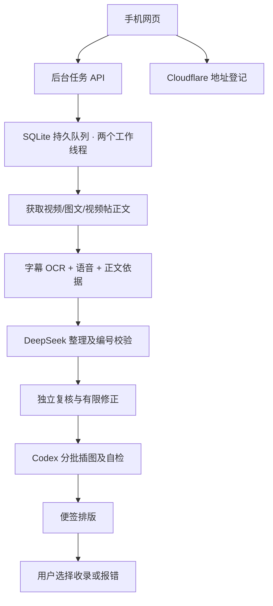

# 架构与数据流

共享下载浏览器、识别模型和绘图资源分别加锁，并行任务并非同时无限创建模型。阶段缓存按输入和规则摘要识别，内容及规则发生变化会重新计算相关阶段。JSON 快照采用独立临时文件和原子替换。

每个任务在 work/cloud-data/jobs 下保留原始依据、模型返回、校验与复核结果、图像检查点和耗时。保存已完成阶段可避免无意义重做；API 被限额、正文缺失、图片生成失败不能被缓存为成功。

文字中不确定的内容保留问号或说明；模型 suggestions 不自动成为事实。用户反馈、系统复核失败、长期未收录归档是不同类型，未收录不等于识别错误。反馈审计与典型问题改进由维护者进行；源码没有内置无限自动学习或无人审核改规则系统，也不会自动创建 Codex 定时任务。

Cloudflare KV 仅公开当前后台 URL 和更新时间；写入使用独立 Bearer 密钥。食谱、账户登录和 DeepSeek 密钥留在私有后台。前端访问口令存于浏览器 localStorage，同一站点的数据清除或设备更换会失效。
